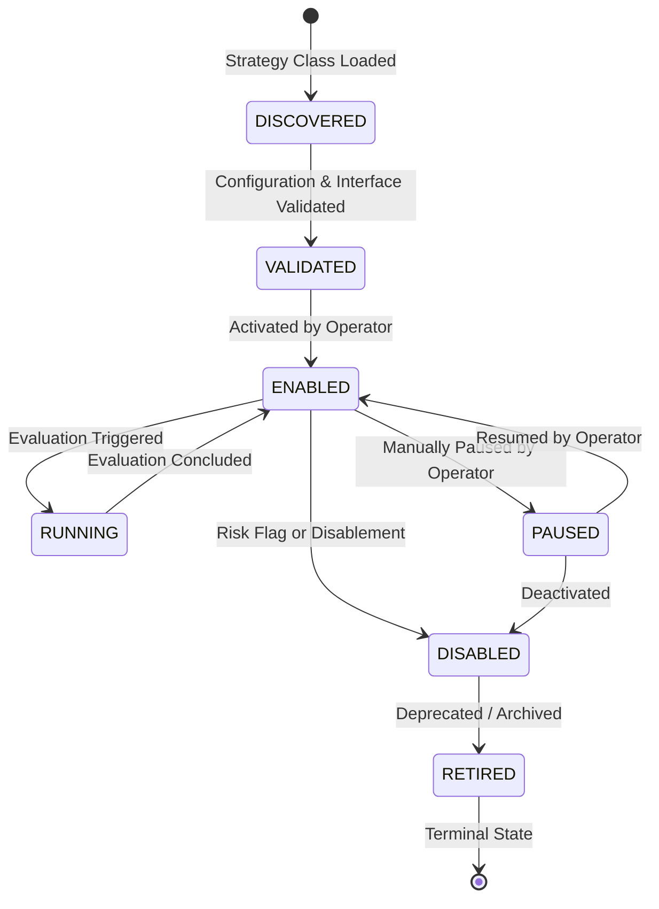

# P10.2-G — Strategy SDK, Plugin Contract & Isolation Specification

## 1. Overview & Architectural Principles

Phase **P10.2-G** introduces a versioned, provider-neutral **Strategy SDK** for the Memecoin Intelligence, Forensics & Trading OS. It enables modular algorithmic research, backtesting, and simulated trading strategies to evaluate multi-chain market signals while maintaining strict defensive boundaries.

### Core Architectural Invariants:
1. **Signal Proposal Boundary (Strict Invariant):**
   Strategies produce **proposed signals or trade intents only** (`BUY`, `SELL`, `HOLD`, `INVALID`).
   Strategies **NEVER**:
   - Execute live orders or interact with blockchain RPC signing nodes.
   - Mutate cash or token balances.
   - Post ledger entries directly.
   - Bypass Core pre-trade risk controls.
   - Access API private keys, wallet signers, or credential vaults.
2. **Defensive Isolation:**
   Strategy code is treated as untrusted plugin logic. Execution is mediated through `StrategyExecutionSandbox` with hard execution timeouts, input payload volume caps, defensive memory containment, and strict exception shielding.
3. **Multi-Chain Capability Awareness:**
   Strategies declare supported CAIP-2 chains (e.g. `solana:mainnet`, `eip155:8453`) and required capability vectors. The Core engine rejects execution on unsupported or incompatible networks.
4. **Deterministic Replay:**
   Every strategy evaluation captures an immutable snapshot hash (`input_dataset_hash`), input context JSON, configuration snapshot, execution duration, and produced signal into SQLite. Any historical run can be replayed deterministically via `replay_evaluation()`.

---

## 2. Strategy Lifecycle State Machine

Strategies follow a deterministic, monotonic lifecycle state machine:



### Lifecycle Rules:
- **`DISCOVERED`**: Strategy plugin class is registered in the registry, metadata inspected.
- **`VALIDATED`**: Configuration parameters passed schema and semantic validation.
- **`ENABLED`**: Active and ready to receive evaluation requests.
- **`RUNNING`**: Actively executing inside an isolated sandbox thread.
- **`PAUSED`**: Temporarily suspended by operator; evaluations are refused.
- **`DISABLED`**: Inactivated due to risk limits or manual disablement; evaluations raise `PermissionError`.
- **`RETIRED`**: Terminal state. Cannot transition back to `ENABLED`.

---

## 3. Signal Contract & Explicit Amount Sizing

The `StrategySignal` model implements a typed contract distinguishing between raw atomic integer amounts and human-normalized decimal units:

```python
class StrategySignal(BaseModel):
    signal_id: str                      # Unique UUID hex identifier
    run_id: str                         # Execution run UUID
    strategy_id: str                    # Registered strategy ID
    strategy_version: str               # Semantic version
    chain_id: str                       # CAIP-2 chain identifier
    asset_id: str                       # Target asset address/mint
    pool_id: Optional[str]              # AMM pool identifier
    action: StrategyAction              # BUY, SELL, HOLD, or INVALID
    confidence: float                   # Range [0.0, 1.0]
    entry_reference_price_native: Optional[Decimal]
    entry_reference_price_usd: Optional[Decimal]
    price_source: str                   # CORE_MARKET_SNAPSHOT, CORE_AMM_POOL, etc.
    
    # Explicit Amount-Unit Contracts:
    suggested_size_raw: Optional[Decimal]   # Atomic integer units: e.g. 250,000,000 for 250 USDC (6 decimals)
    suggested_size_human: Optional[Decimal] # Human-readable units: e.g. 250.0 USDC
    
    stop_loss_pct: Optional[float]      # Suggested stop loss percentage
    take_profit_pct: Optional[float]    # Suggested take profit percentage
    reasons: List[str]                  # Machine-parseable reason codes
    human_explanation: str              # Audit-friendly narrative description
    data_provenance: Dict[str, Any]     # Snapshot hashes, price points, volumes
    input_dataset_hash: str             # SHA256 hash of normalized input context
    input_timestamp: datetime           # Timestamp of input market data
    expires_at: datetime                # Signal TTL expiration (default: 5-15 mins)
    created_at: datetime                # Signal creation timestamp
```

### Amount-Unit Contract Guarantee:
To prevent unit-mismatch errors across chains with differing decimal standards (e.g. Solana 6/9 decimals, EVM 18 decimals):
$$\text{suggested\_size\_raw} = \text{int}\left(\text{suggested\_size\_human} \times 10^{\text{token\_decimals}}\right)$$
The Strategy SDK resolves token decimals fail-closed from the Core asset database (`discovered_tokens`), never allowing silent unit fabrication.

---

## 4. Execution Sandbox & Isolation Model

The `StrategyExecutionSandbox` implements defensive fault isolation:

```
                      +------------------------------------------+
                      |           Core StrategyService           |
                      +------------------------------------------+
                                           |
                                           v
                      +------------------------------------------+
                      |        StrategyExecutionSandbox          |
                      |  - Payload Size Limiter (<= 512 KB)      |
                      |  - Hard Timeout Timer (ThreadPoolWorker) |
                      |  - Exception Containment Barrier         |
                      +------------------------------------------+
                                           |
                                           v
                      +------------------------------------------+
                      |             Strategy Plugin              |
                      |  - Context: Immutable, Read-Only         |
                      |  - Keys / Signer / Vault: None           |
                      |  - Database Write Handles: None          |
                      |  - Live RPC Sockets: None                |
                      +------------------------------------------+
```

### Verified Sandbox Containment Properties:
1. **Execution Timeout Containment:**
   Each strategy declares a `timeout_seconds` (default: 3.0s, maximum: 10.0s). Sandbox launches evaluation in an isolated worker thread managed by `concurrent.futures`. If execution exceeds the ceiling, the thread is canceled, and an `INVALID` signal with reason `EXECUTION_TIMEOUT` is immediately returned without crashing the Core server.
2. **Unhandled Exception Containment:**
   Any uncaught runtime error (e.g. `ZeroDivisionError`, `KeyError`, syntax error) is trapped by the sandbox, logged to `strategy_audit_log`, and converted into an `INVALID` signal with `STRATEGY_EXCEPTION`.
3. **Payload Size Guard:**
   Input contexts and configuration dictionaries are serialized and checked against a 512 KB volume ceiling to prevent memory denial-of-service.
4. **Credential & Database Shielding:**
   `StrategyInputContext` contains no references to `CredentialVault`, private keys, wallet signers, or SQLite database write handles.

### Android Termux & Non-Root Linux Sandbox Disclosure:
> [!IMPORTANT]
> On Android Termux and unprivileged Linux environments, kernel namespaces (`clone(CLONE_NEWPID)`), cgroups, and seccomp-bpf filter syscalls are unavailable or restricted without root permissions.
> 
> Therefore, Strategy SDK isolation operates at **Defensive Application-Level Isolation**:
> - Execution runs in dedicated Python worker threads with hard timeouts.
> - Input contexts are passed by value as immutable frozen models (`model_config = {"frozen": True}`).
> - File system, process spawning, and network containment rely on OS process permissions. Strategies must not attempt raw socket bindings or file writes outside designated workspace scratch directories.

---

## 5. Built-in Reference Strategies

### 1. Volume-Confirmed Momentum Breakout (`momentum_breakout` v1.0.0)
- **Class:** `MomentumLookbackStrategy`
- **Logic:** Compares the earliest historical lookback snapshot (`snaps[0]`) to the latest market price (`curr_price_usd`). If price increase exceeds `min_price_change_pct` (default: 5.0%) and 24h volume exceeds `min_volume_24h_usd` (default: $10,000), generates a `BUY` signal. If price decrease drops below `-min_price_change_pct`, generates a `SELL` signal.
- **Risk Protection:** Requires minimum pool liquidity ($15,000 default); checks market data freshness (<300s); sets automatic `stop_loss_pct` (8.0%) and `take_profit_pct` (20.0%).

### 2. Liquidity & Risk Filter Accumulator (`safety_first_accumulator` v1.0.0)
- **Class:** `LiquidityRiskFilterStrategy`
- **Logic:** Designed for forensic-first capital preservation. Evaluates automated security scans (`security_scans`). If honeypot is detected, mint authority is active, or risk score exceeds `max_risk_score` (default: 35.0), emits an immediate `HOLD` signal with reason `EXCESSIVE_RISK_SCORE` or `HONEYPOT_DETECTED`.
- **Accumulation:** When security parameters pass and liquidity exceeds $25,000, generates structured fractional buy proposals.

---

## 6. Orchestrator Integration: Windmill & Hermes

| Component | Architecture Role | Capabilities & Boundaries |
|:---|:---|:---|
| **Core OS** | **Owner & Authority** | Owns strategy registration, configuration persistence, SQLite storage, sandbox dispatch, signal generation, and pre-trade risk validation. |
| **Windmill** | **Primary Orchestrator** | Schedules periodic evaluation workflows (`wf08_opportunity_scoring.py`, `wf20_simulated_execution.py`), polls API endpoints, and orchestrates pipeline batches. |
| **Hermes** | **Optional AI Analyst** | Strictly **READ-ONLY**. Synthesizes qualitative dossiers (`synthesize_token_dossier`), provides contextual summaries. Has no execution handles, cannot alter strategy lifecycles, and cannot propose trades. |
| **n8n** | **Deferred** | Not deployed in Version 1. Excluded from orchestration path. |

---

## 7. Database Persistence (Migrations 8 & 9)

### Migration 008 (`008_strategy_sdk_signals_and_audit`):
1. **`strategy_definitions`**: Registered strategy class metadata, versions, author, supported chains, schema.
2. **`strategy_configurations`**: Per-strategy, per-chain operational parameters, and risk limits.
3. **`strategy_runs`**: Execution log capturing input hashes, execution duration, status, and error logs.
4. **`strategy_signals`**: Immutable generated signals with raw/human sizes, price sources, confidence, TTL.
5. **`strategy_audit_log`**: Tamper-evident ledger of all lifecycle changes, configuration edits, and evaluations.

### Migration 009 (`009_strategy_proposals_and_replay_context`):
6. **`strategy_proposals`**: Idempotent intent proposals with `UNIQUE(signal_id, account_id)`, tracking desk account authorization, risk limits validation, and execution status (`PROPOSED_ONLY`, `CONSUMED`, `REJECTED`, `EXPIRED`).
7. **Replay Context Column**: `ALTER TABLE strategy_runs ADD COLUMN input_context_json TEXT;` for lossless, deterministic historical replay.

---

## 8. REST API Endpoints & Protection

All mutating and execution endpoints are protected by `verify_strategy_access` (loopback enforcement `127.0.0.1`/`::1`/`localhost` or mandatory `ADMIN_API_TOKEN` header):

- `GET /api/v1/strategies`: List all registered strategies and metadata.
- `GET /api/v1/strategies/{strategy_id}`: Get metadata and active configuration for a strategy.
- `POST /api/v1/strategies/{strategy_id}/validate-config`: Validate configuration parameters against schema (Protected).
- `POST /api/v1/strategies/{strategy_id}/config`: Save configuration parameters for a strategy and chain (Protected).
- `POST /api/v1/strategies/{strategy_id}/status`: Transition strategy lifecycle state (`ENABLED`, `PAUSED`, etc.) (Protected).
- `POST /api/v1/strategies/{strategy_id}/evaluate`: Execute strategy evaluation within sandbox (Protected).
- `POST /api/v1/strategies/replay`: Deterministically replay a historical evaluation run (Protected).
- `POST /api/v1/strategies/propose-intent`: Bridge signal to Core pre-trade risk validation with idempotency (Protected).
- `GET /api/v1/strategies/{strategy_id}/signals`: Query historical signals produced by a strategy.
- `GET /api/v1/strategies/{strategy_id}/runs`: Query evaluation run execution history and durations.

---

## 9. P10.2-G.2 Critical Remediations Summary

1. **Fail-Closed Asset Decimals:** Implicit 18-decimal fallbacks and ambiguous `> 100000` heuristics are completely eliminated from the strategy evaluation path. Unverified or missing token decimals immediately emit `INVALID` signals with reason `UNVERIFIED_ASSET_DECIMALS`.
2. **Trusted Built-in Policy:** Only reviewed, allowlisted built-in strategies (`momentum_breakout` v1.0.0, `safety_first_accumulator` v1.0.0) may be registered. Dynamic registration of arbitrary user code is prohibited.
3. **In-Process Thread Limitations & Starvation Guard:** Python worker threads cannot be forcibly killed on timeout; to prevent starvation, admission is strictly bounded (`max_workers=4`, `max_queue_size=4`), rejecting excess requests with `WORKER_POOL_EXHAUSTED` / `BUSY`. Late worker results on abandoned threads are dropped.
4. **Idempotent Intent Proposals:** Persistent table `strategy_proposals` enforces `UNIQUE(signal_id, account_id)`. Repeated requests return cached proposals; cross-account proposals are rejected with `HTTP 403 Forbidden`.
5. **Exact Precision Replay:** Historical replay reconstructs exact context from stored `input_context_json` verified against SHA-256 `input_dataset_hash`. Fractional amounts are quantized using `quantize(Decimal(10)**-token_decimals, rounding=ROUND_DOWN)` preserving exact satoshi/atomic units.
6. **Deep Immutability:** `StrategyInputContext.to_deeply_immutable()` wraps nested mappings in `MappingProxyType` and sequences in `tuple`s, preventing strategies from mutating input contexts.
